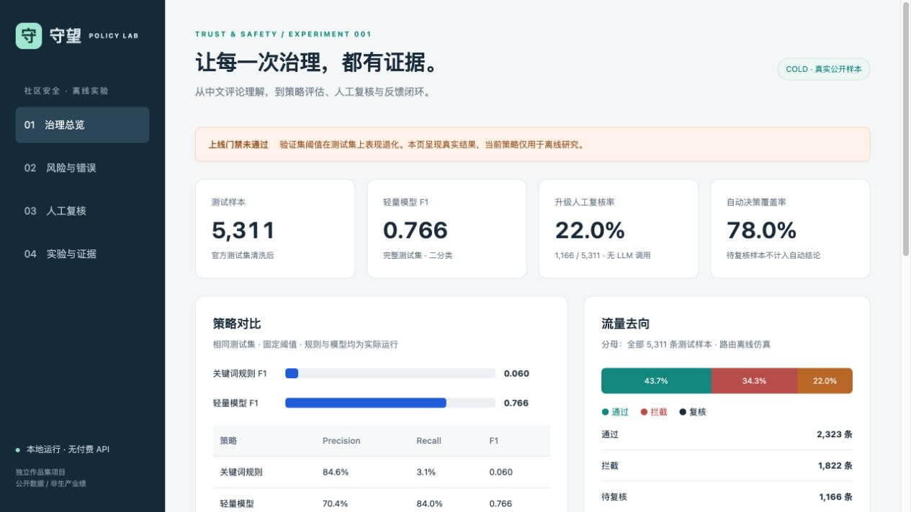
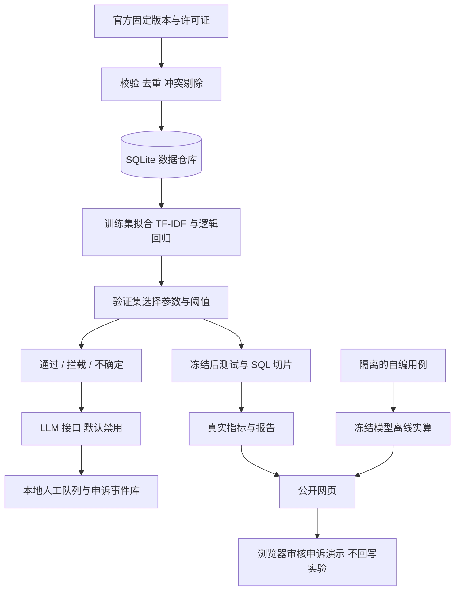

# 守望 · 社区内容安全策略实验室

**中文内容安全独立作品集｜AI辅助开发｜离线实验与交互演示**

用公开评论数据回答三个问题：模型能识别多少冒犯表达？会误伤哪些正常内容？怎样把不确定性和用户反馈接入人工复核？

[在线Demo](https://shouwang-safety-lab-2026.arcane-civet-5667.chatgpt.site) · [4分钟演示路线](docs/INTERVIEW_DEMO.md) · [实验报告](docs/EXPERIMENT_REPORT.md) · [数据卡](docs/DATA_CARD.md)

> 本项目参考社区安全策略运营职责，不代表在任何公司任职，不使用企业内部数据，也不声称生产部署或业务收益。当前自动拦截策略未通过上线门槛。



## 项目背景

社区审核需要同时控制漏放、误杀与人工工作量。本项目构建从数据质量、机审基线到风险分析、人工复核和申诉留痕的最小闭环，重点验证策略是否可靠，而不是只展示模型分数。

## 真实结果与判断

COLD原始37,480条中文评论，清洗保留37,245条；官方划分清洗后为训练25,529、验证6,405、测试5,311。固定随机种子42；特征仅在训练集拟合；阈值只在验证集选择。

|完整测试集策略|Precision|Recall|F1|
|---|---:|---:|---:|
|朴素关键词规则|84.62%|3.14%|0.060|
|字符TF-IDF＋逻辑回归|70.37%|84.04%|0.766|

离线路由：自动通过2,323、自动拦截1,822、待人工1,166（21.95%），自动决策覆盖78.05%。这是路由覆盖率，不是已实现的人力节省。待审样本没有被假定为正确。

**关键失败：** 验证集自动拦截精确率95.00%，在测试集仅77.11%；反偏见表达的二分类误杀率为62.33%（412/661）。因此不支持上线自动拦截，需要新的代表性验证数据与语境建模。

## 两种模式，证据不混用

|模式|输入|计算与保存|用途|
|---|---|---|---|
|公开网页Demo|8条自编演示用例；真实实验聚合结果|冻结轻量模型预计算分数；浏览器本地审核与申诉事件|面试交互，不进入主实验指标|
|本地研究工作台|官方COLD数据和本地实验数据库|真实训练、评测、SQL、队列与SQLite人工事件|复现、分析与扩展|

网页不是在线模型服务，没有LLM调用。评论正文不从COLD数据中公开复制。演示操作只保存在访问者自己的浏览器，不会改动仓库或真实指标。

## 功能

- 固定官方数据版本、SHA-256校验、缺失/冲突/重复检查；规范化跨集合重复组由105降至0。
- SQLite样本、预测、排除原因与复核队列；SQL按类别、话题、路由分析错误。
- 规则与字符模型基线、验证集参数搜索、冻结测试、混淆矩阵与Bootstrap区间。
- 通过/拦截/复核路由；结构化LLM适配器、重试、缓存、异常降级（默认禁用，未实测真实LLM）。
- 公开审核演示：申诉重新入队→人工改判→保留原始路由→事件时间线→一键重置。
- 本地实验报告、数据/模型卡、真实案例复盘与策略治理方案。

## 架构



## 30秒启动面试Demo

需要Python 3；不需要安装机器学习依赖、不需要API key。

```bash
git clone https://github.com/haitaicuiuci/shouwang-community-safety.git
cd shouwang-community-safety
bash run.sh demo
```

打开 http://127.0.0.1:8765 ，按照[演示路线](docs/INTERVIEW_DEMO.md)操作。改端口可用 `PORT=8766 bash run.sh demo`，Ctrl+C停止。演示前重置浏览器记录。

## 完整复现实验

需要Python 3.10+，推荐3.12。首次依赖和数据下载需要联网；安装到项目`.venv`，不会修改全局环境。

```bash
PYTHON=python3.12 bash run.sh setup
bash run.sh reproduce
bash run.sh http-check
bash run.sh serve
```

`reproduce`执行来源校验、数据清洗、建仓、训练、验证选择、测试、报告和单元测试。原始数据不随仓库分发，由下载器从固定官方提交获取并验证哈希。数据和依赖齐全后可离线重跑。

`serve`启动完整本地研究工作台；与`demo`默认端口相同，应先停止另一个服务或修改PORT。重跑保留本地人工事件；不要将旧人工事件作为新模型评测结果。

## 测试与验证

- 13项原有单元测试已通过：数据哈希、无规范化跨集合重叠、路由分母、真值不进入人审、LLM缓存/版本隔离/异常降级、审核申诉状态流转。
- 两次实际运行的划分、冻结策略和逐样本预测SHA-256一致；时延随机器变化，不承诺字节一致。
- HTTP检查在临时数据库中验证接口、审核/申诉、来源限制和原始文件拒绝访问，不产生真实人工结论。
- 公开演示额外进行源码/数据检查与浏览器端到端操作验证，证据见`release/`。
- GitHub Actions在推送后运行复现、测试与公开演示文件检查。结果以Actions实际运行状态为准，不预先宣称通过。

```bash
bash run.sh verify
python tests/check_public_demo.py
```

## 目录

|路径|内容|
|---|---|
|`web/`|公开静态Demo、隔离用例、真实指标快照|
|`src/`|下载、训练评测、LLM接口、级联、本地服务、报告|
|`sql/`|SQLite建表与分析查询|
|`config/`|固定种子、模型参数网格、规则与策略版本|
|`data/source_manifest.json`|来源版本、下载日期、哈希；无原始评论|
|`artifacts/`|可公开的结果、逐样本ID及预测、验证证据|
|`docs/`|数据卡、模型卡、实验、案例、治理与演示讲稿|
|`tests/`|单元测试、HTTP检查与公开Demo检查|
|`release/`|公开版本验证记录|

## 限制与下一步

仅研究中文冒犯表达，无法评估色情、诈骗等无真值类别；源标签不是法律或业务裁决。规范化去重未覆盖语义、作者与时间泄漏。轻量模型分数未经校准。

LLM仅实现接口与模拟测试，未进行真实质量、成本或延迟评测。浏览器事件不是生产人工审核数据。尚未实现线上灰度、持续漂移监控、多用户权限、生产回滚或真实业务价值验证。

下一步：补充独立的反偏见/引用/含蓄攻击验证集，预注册改进方案；用真实人工仲裁评价，再考虑语义模型和LLM。不得按当前测试错误改规则后继续称同一测试集为独立评估。

## 数据授权与归属

Deng et al., *COLD: A Benchmark for Chinese Offensive Language Detection*, EMNLP 2022. [论文](https://aclanthology.org/2022.emnlp-main.796/) · [官方仓库](https://github.com/thu-coai/COLDataset)。固定提交：`a0c55a945497ab58e94aef491180e1cf88ffb864`，下载日期2026-10-21。

官方仓库Apache-2.0许可证和README原样保存在`data/raw/`。新增代码和文档使用Apache-2.0。上游著作权许可不代替第三方隐私和其他权利审查。仓库不包含原始CSV、含评论的数据库、训练模型、密钥或个人审核记录。
